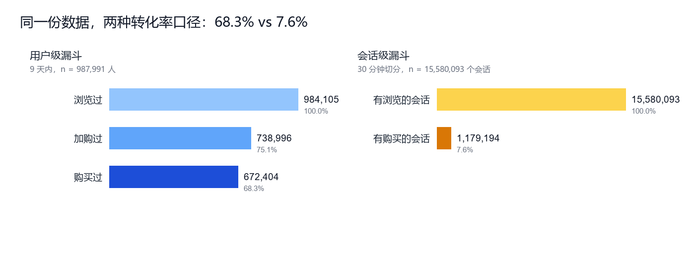
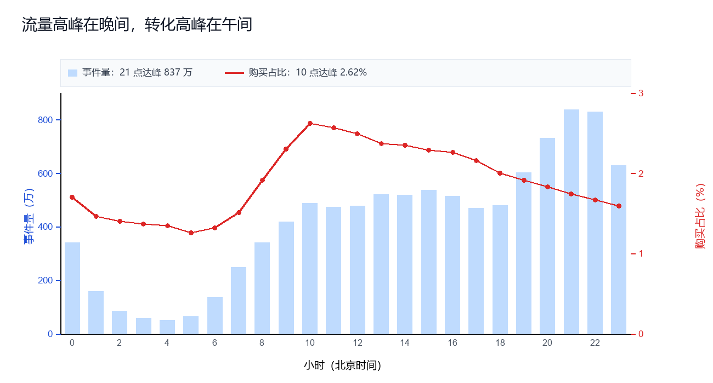
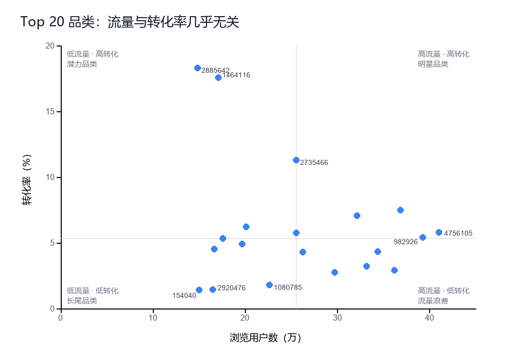

# 淘宝用户行为分析：1 亿条日志里的转化、时段与品类

> 基于阿里天池「淘宝用户购物行为」数据集（2017-11-25 ~ 12-03，约 1 亿条行为日志）。
> **核心结论：同一份数据，用户级转化率 68.3%、会话级转化率 7.6%，相差 9 倍；流量高峰在晚间，转化高峰在午间；品类流量与转化效率几乎无关。**

| 指标 | 数值 |
|---|---:|
| 行为日志 | 100,095,898 条（清洗后） |
| 用户 / 商品 | 约 98.8 万 / 416 万 |
| 观测窗口 | 9 天（2017-11-25 ~ 12-03） |
| 用户级转化率（pv→buy） | **68.33%** |
| 会话级转化率（30 分钟切分） | **7.57%** |
| 次日回访率 | 77.7% ~ 79.6% |
| 品类转化率区间 | 1.39% ~ 18.28% |



---

## 1. 业务问题

淘宝的用户行为日志记录了「谁、在什么时候、对什么商品、做了什么」。本项目回答三个问题：

1. **转化**：从浏览到下单，用户流失在哪一层？不同口径下的转化率差多少？
2. **时段**：什么时间人多、什么时间效率高？两者是否一致？
3. **品类**：哪些品类「看得多买得少」，哪些「看得少但转化高」？

## 2. 数据说明

| 项 | 说明 |
|---|---|
| 来源 | 阿里云天池 · 淘宝用户购物行为数据集 |
| 规模 | 100,150,807 行 × 5 列，无表头，CSV 约 3.4 GB |
| 字段 | `user_id`、`item_id`、`category_id`、`behavior_type`、`timestamp` |
| 行为类型 | `pv` 浏览 / `cart` 加购 / `fav` 收藏 / `buy` 购买 |
| 时间戳 | Unix 秒（UTC），分析时 +8 小时转北京时间 |

**数据清洗**：原始 100,150,807 行中，54,751 行（0.0547%）的时间戳落在观测窗口外——包括 11-22~11-24 的越界记录，以及少量异常值（最小 −2.13e9、最大 2.12e9，对应 1902 与 2037 年）。按 `[2017-11-25, 2017-12-04)` 过滤后保留 100,095,898 行。

> 校验方式：行数 + 主键基数 + 时间戳值域三件套。仅看 `COUNT(*)` 无法发现时间戳异常。

## 3. 三个发现

### 3.1 口径之差：68.3% vs 7.6%

| 口径 | 定义 | 转化率 |
|---|---|---:|
| 用户级 | 9 天内既浏览过又购买过的用户占比 | **68.33%** |
| 会话级 | 相邻行为间隔 > 30 分钟切分，会话内产生购买的比例 | **7.57%** |

前者衡量「人群覆盖」，后者衡量「单次访问效率」，**相差 9 倍**。只报 68% 会让人误判运营效率，只报 7.6% 会丢掉「用户很活跃」的信息。

> 注意：68% 是这份高活跃样本的口径，**不是淘宝真实转化率**。

### 3.2 时段：量的峰在 21 点，率的峰在 10 点



- 事件量峰值：21 点（837 万）
- 购买占比峰值：10 点（2.62%）
- 绝对下单量峰值：仍在 21 点（约 14.6 万），但流量多 72% 而单量只多 14%

**晚间流量"虚胖"**：人多但转化效率低。晚间适合曝光与内容推荐，午间适合促销转化。

### 3.3 品类：流量与转化效率基本无关



- 转化率区间 **1.39% ~ 18.28%**，相差 13 倍
- 浏览份额集中在 0.6% ~ 1.8%，流量分配与转化效率无明显关系
- 「高流量 + 高转化」的明星品类**几乎不存在**（图中右上角为空）

业务含义：把 `154040`、`2920476` 这类高流量低转化品类的流量，挪一部分给 `2885642`、`1464116` 这类低流量高转化品类。

## 4. 分析方法

| 步骤 | 文件 | 说明 |
|---|---|---|
| 建表与校验 | `sql/00_load.sql` | 显式列类型，避免自动探测出错 |
| 清洗 | `sql/01_clean.sql` | 左闭右开区间过滤，剔除 0.05% 脏数据 |
| 用户级漏斗 | `sql/02_funnel_user.sql` | 人群覆盖口径 |
| 会话级漏斗 | `sql/03_funnel_session.sql` | `LAG` + 累计 `SUM` 生成会话 ID |
| 品类分析 | `sql/04_category.sql` | 最小样本阈值 5,000 |
| 时段分析 | `sql/05_time_of_day.sql` | 含工作日/周末拆分 |
| 回访率 | `sql/06_retention.sql` | 排除最后一天，避免边界效应 |
| RFM | `sql/07_rfm.sql` | 仅 R 与 F（无金额字段） |

**口径说明**：
- 会话切分阈值取 30 分钟（行业惯例），改成 15 或 60 分钟结论会变化
- 时间戳统一用 `make_timestamp(秒 × 1000000) + INTERVAL 8 HOUR` 转换，`to_timestamp()` 对整数参数行为不直观
- 回访率只算日回访：9 天窗口没有注册/首购事件，做不了 cohort 留存

## 5. 局限

1. **窗口过短**：9 天无法观察长期留存、复购周期或营销疲劳；R 的取值被截断在 0–9 天，RFM 仅作方法演示。
2. **采样偏差**：12-01 起 DAU 从 73 万跃升至 97 万（接近全样本 98.8 万），回访率因此跳到 98%，属数据构造的边界效应，不作为结论。
3. **无金额字段**：无法计算 GMV、客单价、ROI；品类转化率只反映人群覆盖效率。
4. **购买行为未区分支付状态**：`buy` 可能是下单，不等于支付成功。
5. **F 的口径**：`COUNT(*)` 数的是购买行为条数，不是订单数，多商品下单会高估频次。

## 6. 复现

```bash
# 1. 下载 UserBehavior.csv 放到 data/
# 2. 建库并导入（约 2-4 分钟）
duckdb taobao.duckdb < sql/00_load.sql
duckdb taobao.duckdb < sql/01_clean.sql

# 3. 逐项分析
duckdb taobao.duckdb < sql/02_funnel_user.sql

# 4. 或直接打开 notebook
jupyter notebook notebooks/01_analysis.ipynb
```

## 7. 项目结构

```text
.
├── data/UserBehavior.csv          # 原始数据，不纳入版本控制
├── sql/                           # 全部分析查询，按步骤编号
├── notebooks/01_analysis.ipynb    # 分析过程与结果展示
├── figures/                       # 图表
├── taobao.duckdb                  # 本地数据库，不纳入版本控制
├── .gitignore
└── README.md
```

## 8. 后续可做

- 补充金额维度后重做 RFM 的 M 与品类 GMV 贡献
- 用 30 分钟会话做路径分析（浏览 → 加购 → 下单的跳转概率）
- 引入商品类目层级，做「品类内排名 vs 转化率」的交叉分析
